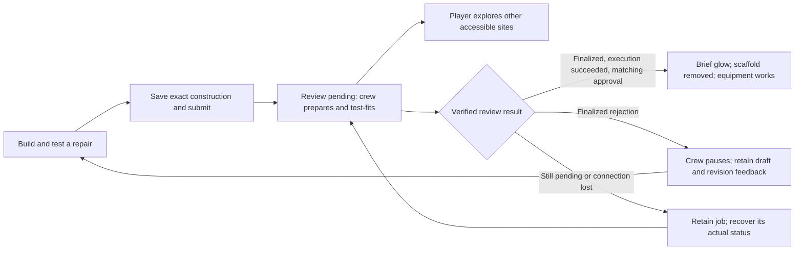

# Repair review without stopping the adventure

The construction and its review are separate from the animation. Builders make a waiting site feel active, but they do not decide whether a design passes.

In connected mode, approval must match the player, island site, fixture version, nonce, design digest and transaction. An accepted transaction alone is not enough. Neither a long wait nor the end of a hammering clip restores machinery or opens a route.

While pending, crew members inspect fittings, carry tools and hammer temporary braces. The original fault and inaccessible route remain visible. A player can walk away; the saved pending job belongs to the site, not an open repair panel. There is no invented percentage or completion countdown.

On approval, a short light pulse draws attention to the change. Persistent geometry and behaviour then show the result: a spinning windmill, flowing clean water, a safe bridge, restored path lighting or a controlled beacon. Local vegetation and damage recover alongside that specific repair. The glow is temporary; the working repair is persistent.

On rejection, amber revision cues replace active work. The construction is retained so the player can change it using the review feedback. A network timeout does not become a rejection or approval; the pending transaction must be reconciled before another submission.

Local practice is a separate mode. Its checks are deterministic and run in the browser; it does not claim GenLayer or AI validation. A local assembly animation may play after those checks, but it never fabricates a network wait or promotes practice progress into connected approval.

This is the intended product behaviour. Native gameplay evidence and the independent Game Builder gates establish what the delivered implementation actually does. Public deployment and player transactions remain outside this local build until separately authorized.

## Acceptance checks for the delivered game

- Submit through a player action, close the repair panel and walk to another accessible site. The first site's tentative work continues, but its fault and route lock remain.
- Observe pending, accepted and unknown-execution states for longer than a complete worker animation. None may trigger the completion pulse, usable machine or new route.
- A matching finalized, successfully executed approved receipt changes only its own site. Its one-time light pulse ends while its physical repaired state persists.
- A rejected or failed review pauses workers and retains the exact submitted construction and useful feedback. A revised design requires a new explicit submission; a timeout instead offers recovery of the original transaction, not rebroadcast.
- Save and reopen during review. Recovery must verify the original broadcast and repair evidence without another signing request. Saved UI state and a cached “completed” value are never authority.
- Reopen after approval. Original approved transaction evidence is retained separately from pending work and reverified before connected progression is restored. Account, contract, network and fixture-version changes cannot inherit it.
- On a landscape phone, the player, work site and repair controls remain visible without overlap. The 3D inspection view and its hit targets use the panel's actual visible rectangle, including keyboard-open layout.

For worker-motion captures, retain a grounded body, alternating foot movement when carrying tools and believable hand/tool contact when hammering. A worker looping in place is not a construction progress percentage. Scripted test review outcomes must be labelled as such; they are not evidence of a live GenLayer decision.

## Rig integration research

These are integration requirements for the later character/crew pass, not claims that final animation is already in the game.

The inspected restorer GLB supplies a skin and documented bones. Reuse that same gated body for the hero and workers. Three.js's [SkeletonUtils documentation](https://threejs.org/docs/pages/module-SkeletonUtils.html) describes cloning the containing hierarchy so each skinned mesh stays associated with its cloned bones; geometry and material data remain shared. Preserve reusable textures/geometry, but isolate any worker-specific material colours so a crew tint cannot unexpectedly recolour the hero. The installed utility was also read for the actual clone/rebind path.

Independent poses or animation clocks should let the alignment worker and guard-fitting worker have distinct rhythms and pause states. The [AnimationMixer documentation](https://threejs.org/docs/pages/AnimationMixer.html) supports a separate mixer per independently animated object when clips are used. This does not require inventing missing clips: the gated rig's documented bind transforms also support the planned continuous pose binding. Neither animation time nor a clip-complete callback may act as review authority.

Native motion evidence must show planted feet during tool work, hand/tool contact, separate working/revision/finishing states and the functional equipment after the glow ends. Checking only an idle studio render does not establish these behaviours.
